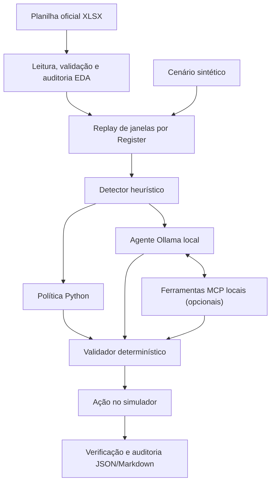

# oran-agentic-lab

Laboratório educacional e de pesquisa sobre análise de KPMs históricos de uma rede 5G Open RAN experimental. O objetivo é verificar quais padrões merecem investigação por uma regra de referência, avaliar as propostas de um modelo local e medir o custo de introduzir o agente no ciclo de decisão. A planilha veio de uma coleta por xApp. O replay usa registros históricos, e as ações têm efeito apenas no simulador. A condição suspeita é um alerta heurístico, sem rótulo de falha comprovada.

## Arquitetura



A EDA registra abas, tipos, lacunas e gráficos. O detector usa uma referência histórica de throughput UL e contextualiza a queda pelo PRB UL na escala original. O simulador registra alertas, prioriza eventos, amplia janelas de análise, intensifica a inspeção ou aceita `nenhuma_acao`. A política Python serve de referência e de fallback para propostas Ollama inválidas. O cliente MCP oferece uma demonstração por stdio e o agente usa ferramentas MCP em memória quando habilitadas.

## Requisitos e compatibilidade

| Uso | Requisitos |
| --- | --- |
| Instalação e modo Python | CPython 3.11 ou superior com `venv` e `pip`. Use a série 3.13 para reproduzir a referência da CI. O `pip` instala pandas, openpyxl e matplotlib nas versões fixadas. Git serve para obter uma cópia do repositório. |
| Suíte de testes | Extra `test` (pytest). Instale também o extra `mcp` para executar os testes desse módulo. As planilhas da suíte são sintéticas. |
| EDA ou replay oficial | Planilha da revisão auditada e SHA-256 válido. O cenário sintético funciona sem esse download. |
| Agente local | Ollama, serviço HTTP em loopback e uma tag local instalada. Os exemplos usam `qwen2.5:1.5b`. |
| Ferramentas MCP | Extra `mcp` (SDK Python oficial). A demonstração por stdio funciona sem Ollama. |

Como ponto de partida, use uma CPU de 64 bits com quatro núcleos, 8 GiB de RAM e 2 GiB livres para o modo Python e os testes. Para Ollama com a tag de 1,5 bilhão de parâmetros, prefira 16 GiB de RAM e pelo menos 5 GiB livres para ambiente, runtime, modelo e saídas. São recomendações do laboratório. GPU é opcional e o custo varia com modelo, quantização e contexto. A tag de referência tem cerca de 986 MB. [Ficha da tag](https://ollama.com/library/qwen2.5:1.5b)

| Sistema | Evidência |
| --- | --- |
| Windows | Etapa 5.1 validada localmente em Windows 11 AMD64 com Python 3.13.0. O status detalha testes e integrações executadas. |
| Linux | Etapas 0 a 5 aprovadas com 116 testes informados. A nova revisão ainda aguarda execução no runner. |
| macOS | Execução prevista com os comandos Bash/Zsh. A validação aguarda a execução no runner. |

O histórico e as versões medidas estão no [status do projeto](docs/STATUS_PROJETO.md).

## Instalar o laboratório

Obtenha o repositório com Git e entre na pasta criada. Também é possível extrair o ZIP do GitHub e abrir um terminal na pasta extraída.

```sh
git clone https://github.com/1LucasSilv/oran-agentic-lab.git
cd oran-agentic-lab
```

### **Windows (PowerShell).** 
Instale Python 3.13 da distribuição oficial e certifique-se de que o lançador `py` está disponível. Feche e reabra o terminal após instalar. [Distribuição oficial do Python](https://www.python.org/downloads/)

```powershell
py -3.13 -m venv .venv
.\.venv\Scripts\Activate.ps1
python -m pip install -e ".[test,mcp]"
```

### **Linux e macOS (Bash ou Zsh).** 
Instale Python 3.13 com `pip` e `venv` pelo gerenciador da distribuição ou pelo instalador oficial do macOS. Algumas distribuições Linux empacotam `venv` separadamente. Use `python3.13 --version` para confirmar o interpretador. [Distribuição oficial do Python](https://www.python.org/downloads/)

```bash
python3.13 -m venv .venv
source .venv/bin/activate
python -m pip install -e ".[test,mcp]"
```

O `pip` resolve e baixa as dependências Python. Para instalar só o núcleo, use `python -m pip install -e .`. Para incluir pytest, use `python -m pip install -e ".[test]"`. 

> **Diagnóstico de Instalação:**
O diagnóstico abaixo informa as versões, os recursos do host e o estado dos componentes opcionais. Execute os próximos comandos na raiz do repositório.

```sh
python scripts/check_environment.py
python -m pip check
python -m pytest -q
oran-loop --sintetico --modo python --saida results/minha-execucao/python-sintetico
```

Para ativação bloqueada no PowerShell ou outras configurações, consulte o [guia de instalação](docs/INSTALACAO.md).

## Baixar a planilha e executar EDA e replay

Use a mesma sequência no PowerShell, Bash ou Zsh. O primeiro comando baixa a revisão fixada abaixo, valida o SHA-256 antes de publicar o arquivo e reutiliza um arquivo local válido. O segundo verifica a cópia local sem acessar a rede. Para download manual, salve o Excel do link de origem com o mesmo nome em `data/raw/` e rode a verificação.

- **Revisão** `328ab90c9faabbba6a036255ac503683c227fa34`. [Baixar a planilha da revisão auditada](https://raw.githubusercontent.com/CTTCADAPTRU/OAI-KPM-dataset/328ab90c9faabbba6a036255ac503683c227fa34/20250321_11.17.57_KPM_vs_iper3_1000ms_05_weeks%282%29.xlsx)
- **SHA-256** `d570d8c0567b7ec85fd5e3ca865d1cc109dc741583b01d3ee4f1ff964892d30c`.

```sh
python scripts/download_dataset.py
python scripts/download_dataset.py --verificar
```

**PowerShell**

```powershell
$arquivo = 'data/raw/20250321_11.17.57_KPM_vs_iper3_1000ms_05_weeks(2).xlsx'
```

**Bash ou Zsh**

```bash
arquivo='data/raw/20250321_11.17.57_KPM_vs_iper3_1000ms_05_weeks(2).xlsx'
```

**Comandos comuns aos três shells**

```sh
oran-eda "$arquivo" --saida results/minha-execucao/eda
oran-replay "$arquivo" --saida results/minha-execucao/detector
oran-loop "$arquivo" --modo python --saida results/minha-execucao/python-oficial
```

Use `oran-replay --help` para escolher aba, tamanho e avanço de janela. O modo `--somente-replay` gera o inventário sem aplicar o detector.

## Executar Ollama e MCP

No **Windows**, execute o instalador oficial do Ollama e reabra o terminal. [Windows](https://docs.ollama.com/windows)

No **macOS**, instale o aplicativo e abra-o para preparar o serviço e a CLI. [macOS](https://docs.ollama.com/macos)

No **Linux**, use o comando abaixo ou instale o pacote manualmente. [Linux](https://docs.ollama.com/linux)

```bash
curl -fsSL https://ollama.com/install.sh | sh
```

Se o serviço ainda não estiver ativo, deixe `ollama serve` rodando em um terminal separado.

Em um terminal com o ambiente do projeto, execute o download adicional do modelo e confirme a tag. Para outro modelo local, use a mesma tag em `ollama pull`, `check_environment.py --modelo` e `oran-loop --modelo`.

```sh
ollama pull qwen2.5:1.5b
ollama list
python scripts/check_environment.py --modelo qwen2.5:1.5b
oran-loop --sintetico --modo ollama --max-chamadas 2 --saida results/minha-execucao/ollama
python -m oran_lab.mcp_client --saida results/minha-execucao/stdio.json
oran-loop --sintetico --modo ollama --mcp --max-chamadas 6 --saida results/minha-execucao/ollama-mcp
```

Para usar o agente sobre o Excel, troque `--sintetico` por `"$arquivo"` e escolha outro `--saida`. Inspecione os registros de proposta, validação e fallback para identificar quais decisões vieram do modelo.

## Validar integrações opcionais

A suíte padrão deixa as integrações com o serviço real do Ollama e com subprocesso MCP stdio desativadas. O teste do Ollama usa a tag e a API padrão e requer ambos disponíveis. O teste stdio requer o extra MCP e permissões para subprocesso e pipes.

**PowerShell**

```powershell
$env:ORAN_TEST_OLLAMA = '1'
python -m pytest -q tests/test_agent.py -k local_ollama_integration
Remove-Item Env:ORAN_TEST_OLLAMA

$env:ORAN_TEST_MCP_STDIO = '1'
python -m pytest -q tests/test_mcp.py
Remove-Item Env:ORAN_TEST_MCP_STDIO
```

**Bash ou Zsh**

```bash
ORAN_TEST_OLLAMA=1 python -m pytest -q tests/test_agent.py -k local_ollama_integration
ORAN_TEST_MCP_STDIO=1 python -m pytest -q tests/test_mcp.py
```

### GitHub Actions

O [workflow Testes](.github/workflows/tests.yml) executa a suíte padrão com Python 3.13 em runners hospedados pelo GitHub para Ubuntu, Windows e macOS. Dispara em pushes para `main`, pull requests destinados a `main` e manualmente. A matriz roda sem dataset oficial, Ollama ou modelos.

Abra **Actions → Testes**, selecione a execução e abra os logs de cada job. Quando o workflow estiver na branch padrão, usuários com acesso de escrita podem abrir **Run workflow**, escolher a branch e rodar a matriz. Erros na preparação do runner, checkout ou acesso a registros de pacotes podem impedir a suíte de iniciar. Se o pytest executar, confira o traceback para localizar o teste e investigar a causa. A configuração da matriz ainda aguarda execução no GitHub. [Como rodar manualmente](https://docs.github.com/en/actions/how-tos/manage-workflow-runs/manually-run-a-workflow)

## Resultados e próximos marcos

| Comando | Saída padrão |
| --- | --- |
| `oran-eda` | `results/eda/`, com relatório Markdown e gráficos PNG |
| `oran-replay` | `results/etapa2/` para o detector ou `results/replay/` para `--somente-replay` |
| `oran-loop` sem modo explícito | `results/etapa3/<origem>/` |
| `oran-loop --modo python` ou `--modo ollama` | `results/etapa4/<modo>/<origem>/` |
| `oran-loop --modo ollama --mcp` | `results/etapa5/ollama-mcp/<origem>/` |
| `python -m oran_lab.mcp_client` | `results/etapa5/stdio.json` |

O replay e o loop escrevem `resultados.json` e `relatorio.md`. Use `--saida` para preservar cada execução, com diretórios distintos por sistema e configuração. Dados brutos, ambientes e saídas locais ficam fora do Git.

Na execução oficial de referência no Linux, o detector produziu 38 janelas sobre 1.138 registros KPM e zero alertas. O cenário sintético permitiu verificar ações e recusas do simulador. Os experimentos com Ollama e MCP demonstraram propostas, consultas e fallback. Esses resultados descrevem os casos executados. Novas medições dependem do modelo, do runtime e do hardware. [Replay](docs/REPLAY_DETECCAO.md) · [Simulador](docs/ACAO_SIMULADA.md) · [Agente Ollama](docs/AGENTE_OLLAMA.md) · [MCP](docs/MCP.md)

As Etapas 0 a 5 estão aprovadas e a Etapa 5.1 entrega a preparação reproduzível e a matriz de testes. As próximas etapas do plano incluem RAG com referências 3GPP, comparação controlada e consolidação. A Etapa 6 aguarda autorização. [Plano técnico](docs/PLANO_LABORATORIO.md) · [Status](docs/STATUS_PROJETO.md) · [Auditoria da planilha](docs/EDA.md) · [Instalação avançada](docs/INSTALACAO.md)
