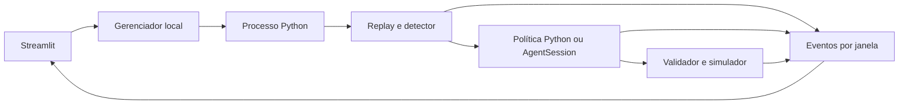

# O-RAN Agentic Lab · Etapa 7.1.1

A interface oferece quatro páginas. **Visão geral** mostra a atividade do laboratório. **Configurar execução** seleciona fonte, modo de decisão e limites. **Monitoramento** acompanha o replay histórico. **Inspeção do agente** abre a trilha de uma janela concluída.

## Instalação e abertura

Na raiz do repositório, use o ambiente virtual descrito no [README](../README.md). Os comandos são iguais no Windows PowerShell, no Linux e no macOS:

```sh
python -m pip install -e ".[ui]"
oran-ui
```

Abra `http://127.0.0.1:8501` no navegador. Use `oran-ui --porta 8502` se a porta padrão estiver em uso. O lançador mantém a escuta em loopback. O extra instala Streamlit 1.67.0 e Plotly 6.6.0. [Streamlit no PyPI](https://pypi.org/project/streamlit/1.67.0/) · [Plotly no PyPI](https://pypi.org/project/plotly/6.6.0/)

Para usar todos os modos e testar:

```sh
python -m pip install -e ".[ui,mcp,rag,test]"
python -m pytest -q
```

A usa Python e cenários sintéticos sem Ollama ou arquivos externos. B–E usam o Ollama local. A lista de geradores consulta o inventário de tags locais e filtra modelos pela capacidade de geração. D e E requerem o extra MCP. Em C e E, selecione um índice JSON compatível em `data/rag/`. O índice determina o modelo de embeddings e sua compatibilidade é verificada antes da execução. Consulte [RAG](RAG.md) para a preparação explícita de índice e modelo.

## Configurar e acompanhar

| Modo | Decisão | Investigações |
| --- | --- | --- |
| A | Python determinístico | — |
| B | LLM local | — |
| C | LLM local | RAG |
| D | LLM local | MCP |
| E | LLM local | MCP e RAG |

Selecione a demonstração sintética, um dos cenários existentes ou o Excel oficial em `data/raw/`. A interface confere a revisão oficial pelo SHA-256. O tamanho e o avanço da janela, os parâmetros do detector e os limites do simulador são configuráveis. Em B–E também é possível ajustar a elegibilidade das janelas, temperatura, semente, contexto, geração, timeout e teto de chamadas. Os seletores de MCP e RAG aparecem nos modos correspondentes. Um erro de recurso ou combinação é apresentado antes da partida do worker.

- **Pausar** aplica a pausa na próxima fronteira entre janelas. Use **Iniciar em pausa** para aguardar antes da primeira.
- **Avançar uma janela** libera a próxima janela quando o worker está pausado e repõe a pausa depois dela.
- **Continuar** libera o replay até nova solicitação ou até o fim.
- **Interromper** encerra na próxima fronteira e salva as janelas concluídas. Se houver uma chamada HTTP em curso, o worker aguarda sua conclusão ou timeout.

O monitor plota exclusivamente amostras liberadas pelo replay. Sobreposições são reunidas por Register. As linhas de referência e limiar refletem a detecção publicada da janela corrente. Cobertura em percentual é a fração de medições válidas na janela. Throughput e PRB são exibidos na escala registrada. O estado visual, as durações e o histórico vêm dos eventos persistidos. A página identifica a fonte sintética ou histórica e distingue execução operacional de resultado gravado.

A inspeção mostra as evidências enviadas, o texto de resposta do modelo, a proposta, os resultados MCP e os fragmentos RAG apresentados. A verificação estrutural dos IDs tem um campo próprio. A avaliação da pertinência técnica do trecho é humana. A trilha distingue recusa, fallback, aceitação sem efeito e alteração executada. Os estados anterior e posterior pertencem exclusivamente ao simulador.

## Arquitetura e armazenamento



`ui_runs.py` executa pré-verificação, persistência, trava de concorrência e controle por fronteira de janela. A UI chama a mesma API local usada na demonstração. O processo separado reutiliza `run_loop`, `AgentSession`, `MCPWindow`, `RagSession` e `Simulator`. A instrumentação é opcional e o fluxo de terminal continua disponível sem o extra `ui`. A preparação calcula as detecções internamente. O diário, o agente e as ferramentas MCP recebem apenas a janela autorizada ou histórico anterior. O tempo de detector publicado foi medido na preparação e inclui a obtenção da janela no replay.

Cada execução tem um diretório `results/ui/<id>/` com manifesto de configuração, revisão, versões, hashes e digests. O worker grava eventos numerados, estado, pedidos de controle e log. Conclusão e interrupção segura produzem `resultados.json` e `relatorio.md`. Uma falha preserva os eventos e, quando há janelas concluídas, `parcial.json`. O worker não reenvia inferências de uma execução encerrada. Uma trava de processo limita a uma execução operacional ativa, e a chave da submissão torna reruns idempotentes. Abrir a interface novamente permite acompanhar o mesmo worker. Alterações na configuração criam uma nova execução.

A Etapa 7.1.2 está reservada ao gerenciamento de recursos e experimentos. A Etapa 7.1.3 está reservada aos resultados, avaliação científica e modo de apresentação. Os resultados da Etapa 7 ficam em `results/etapa7/` e seguem o [protocolo congelado](EXPERIMENTOS.md).

## Demonstrações locais

As demonstrações usaram Windows 11, Python 3.13.0 e Ollama 0.40.18. Ambas usaram a série sintética do laboratório, em diretórios próprios.

| Modo | Execução em `results/ui/` | Evidência |
| --- | --- | --- |
| A · Python | `e14cca76ec1b4abfab520488cf6ea70b` | Aguardou em pausa, avançou exatamente uma janela, voltou à pausa e concluiu oito janelas após continuar. Registrou um alerta no simulador, com zero chamadas ao modelo. |
| E · Qwen + MCP + RAG | `1378561c70c24f149d39d113dd7a35cc` | Gravou oito janelas e o resultado com quatro chamadas HTTP 200. Duas seleções consultaram o histórico em MCP. Nas janelas 5 e 6, foram apresentados dois trechos com IDs R1 e R2. Na janela 5, uma proposta foi recusada e o fallback registrou o alerta. Na janela 6, o modelo teve uma decisão aceita sem mudança de estado. |

Na execução E, uma leitura concorrente impediu a publicação do status final no Windows. O diário registra a falha e preserva todas as janelas e o resultado produzido. A atualização de status agora repete substituições temporariamente bloqueadas. Um teste injeta a falha e confirma a publicação da conclusão. Uma revalidação Python em `b4d7aeb80a054d2baf250d7df9bb2e0c` concluiu oito janelas sob leitura concorrente. As quatro chamadas ao modelo foram preservadas como evidência.

A suíte padrão teve 160 testes aprovados e dois opcionais ignorados, incluindo Streamlit AppTest e os testes do worker. O `pip check` passou. As capturas das quatro páginas estão em `results/ui/capturas/`. A nova matriz GitHub inclui o extra `ui` e usa fixtures sem depender de Ollama ou do dataset. A validação desta revisão na matriz permanece pendente.
