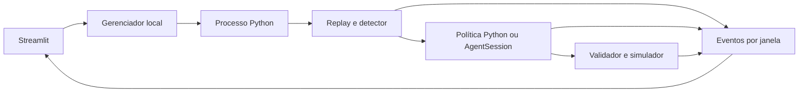

# O-RAN Agentic Lab · Interface local

| Grupo | Página | Uso |
| --- | --- | --- |
| Laboratório | Visão geral | Verifica Ollama, geradores, índices compatíveis e atividade local. Mostra execuções recentes. |
| Laboratório | Configurar execução | Seleciona fonte, arquitetura, parâmetros e limites. Salva a configuração como preset. |
| Laboratório | Monitoramento | Acompanha o replay por janela e controla o worker. |
| Laboratório | Inspeção do agente | Consulta evidência, proposta, ferramentas, referências e efeito no simulador. |
| Pesquisa | Experimentos | Planeja comparações, confirma o teto de chat e acompanha sessões. |
| Pesquisa | Central de execução | Acompanha janelas, sessões, orçamento, componentes e interrupção. |
| Pesquisa | Resultados | Filtra oportunidades e compara indicadores e metadados de execuções. |
| Pesquisa | Avaliação científica | Revisa respostas anonimizadas e guarda lotes de notas humanas. |
| Recursos | Modelos de IA | Consulta tags locais, capacidades, digests, quantização, disco e residência. |
| Recursos | Datasets | Verifica o Excel oficial e audita CSV ou XLSX importados. |
| Recursos | Base de conhecimento | Verifica documentos e índices e permite indexação e busca de teste. |
| Recursos | Cenários e presets | Edita séries sintéticas e gerencia configurações reutilizáveis. |
| Sistema | Modo apresentação | Reproduz eventos gravados em ordem e destaca evidências e efeitos simulados. |

## Instalação e abertura

Na raiz do repositório, use o ambiente virtual descrito no [README](../README.md). Os comandos são iguais no Windows PowerShell, no Linux e no macOS:

```sh
python -m pip install -e ".[ui]"
oran-ui
```

Abra `http://127.0.0.1:8501` no navegador. Use `oran-ui --porta 8502` se a porta padrão estiver em uso. O lançador mantém a escuta em loopback. O extra instala Streamlit 1.67.0 e Plotly 6.6.0. [Streamlit no PyPI](https://pypi.org/project/streamlit/1.67.0/) · [Plotly no PyPI](https://pypi.org/project/plotly/6.6.0/)

A barra lateral começa com 250 px em telas largas, usa ícones Material e mantém os grupos Laboratório, Pesquisa e Recursos visíveis enquanto expandida. A página atual fica em turquesa escuro. O painel inferior consulta a disponibilidade do Ollama, de geradores e índices compatíveis e a atividade do worker. A barra usa o recolhimento nativo. O Streamlit 1.67 oferece largura inicial de 200 a 600 px e recolhimento total. Um trilho permanente de 56 a 72 px com ícones exigiria personalizar o comportamento interno do framework. Os controles das páginas usam widgets nativos. Seleções e rascunhos operacionais e experimentais são mantidos durante a navegação na mesma sessão do navegador. [Navegação do Streamlit](https://docs.streamlit.io/develop/api-reference/navigation/st.navigation) · [Configuração da sidebar](https://docs.streamlit.io/develop/api-reference/configuration/st.set_page_config)

Para usar todos os modos e testar:

```sh
python -m pip install -e ".[ui,mcp,rag,test]"
python -m pytest -q
```

A usa Python e cenários sintéticos sem Ollama ou arquivos externos. B–E usam o Ollama local. A lista de geradores consulta o inventário de tags locais e filtra modelos pela capacidade de geração. D e E requerem o extra MCP. Em C e E, selecione um índice JSON compatível em `data/rag/`. O índice determina o modelo de embeddings e sua compatibilidade é verificada antes da execução. Consulte [RAG](RAG.md) para a preparação explícita de índice e modelo.

## Configurar e acompanhar

| Modo | Decisão | Investigações |
| --- | --- | --- |
| A | Python determinístico | — |
| B | LLM local | — |
| C | LLM local | RAG |
| D | LLM local | MCP |
| E | LLM local | MCP e RAG |

Selecione a demonstração sintética, um dos cenários existentes ou o Excel oficial em `data/raw/`. A interface confere a revisão oficial pelo SHA-256. O tamanho e o avanço da janela, os parâmetros do detector e os limites do simulador são configuráveis. Em B–E também é possível ajustar a elegibilidade das janelas, temperatura, semente, contexto, geração, timeout e teto de chamadas. Os seletores de MCP e RAG aparecem nos modos correspondentes. Um erro de recurso ou combinação é apresentado antes da partida do worker.

- **Pausar** aplica a pausa na próxima fronteira entre janelas. Use **Iniciar em pausa** para aguardar antes da primeira.
- **Avançar uma janela** libera a próxima janela quando o worker está pausado e repõe a pausa depois dela.
- **Continuar** libera o replay até nova solicitação ou até o fim.
- **Interromper** encerra na próxima fronteira e salva as janelas concluídas. Se houver uma chamada HTTP em curso, o worker aguarda sua conclusão ou timeout.

O monitor plota exclusivamente amostras liberadas pelo replay. Sobreposições são reunidas por Register. As linhas de referência e limiar refletem a detecção publicada da janela corrente. Cobertura em percentual é a fração de medições válidas na janela. Throughput e PRB são exibidos na escala registrada. O estado visual, as durações e o histórico vêm dos eventos persistidos. A página identifica a fonte sintética ou histórica e distingue execução operacional de resultado gravado.

A inspeção mostra evidências, resposta bruta, justificativa, tabelas MCP e cartões dos fragmentos RAG apresentados. O expansor de auditoria preserva o JSON integral da janela. A verificação estrutural dos IDs tem um campo próprio. A avaliação da pertinência técnica do trecho é humana. A trilha distingue recusa, fallback, aceitação sem efeito e alteração executada.

Em execuções instrumentadas, o agente verifica o orçamento antes de enviar o contexto, mesmo em modo sem RAG. A estimativa inclui instruções, schema, evidência e uma reserva para a geração. O RAG também verifica quais trechos cabem no orçamento. A estimativa conservadora pode dispensar a chamada ou reduzir o contexto documental. Consulte o motivo registrado e, quando disponíveis, os tokens efetivos do Ollama.

## Gerenciar recursos

- **Modelos.** Atualize o inventário para verificar a geração, os embeddings e a residência. A página distingue tamanho registrado em disco, memória de residência e VRAM informada pelo Ollama. O espaço livre exibido refere-se ao volume do laboratório. O volume dos modelos pode ser outro. O download de uma nova tag exige autorização e mostra o progresso por camada quando o serviço informa os bytes. Para remover, digite a tag exata. Modelos residentes, versões já instaladas e dependências de índices, presets ou resultados históricos são protegidos. [Download](https://docs.ollama.com/api/pull) · [Remoção](https://docs.ollama.com/api/delete) · [Residência](https://docs.ollama.com/api/ps)
- **Datasets.** Envie CSV UTF-8 separado por vírgula ou XLSX, até 16 MiB, 100.000 registros e 256 colunas. Selecione a aba, mapeie os quatro campos e selecione o UE se houver mais de um. A auditoria verifica a ordem e a unicidade de Register no UE selecionado. Lacunas são permitidas e começam outro segmento. Métricas ausentes são preservadas e avaliadas pelo detector segundo sua cobertura. Confirme a escala da origem antes de usar os valores. A versão salva contém os bytes originais, SHA-256, auditoria e a tabela usada no replay.
- **Base de conhecimento.** Confira os hashes e as cláusulas do manifesto oficial. Com os PDFs verificados, escolha um modelo de embeddings instalado e um nome para criar o índice local. A substituição explícita arquiva a versão anterior e exige ausência de referências históricas ou em presets. A busca de teste verifica tag, digest e dimensão e chama somente embeddings. A preparação dos PDFs continua descrita no [guia RAG](RAG.md).
- **Cenários e presets.** Edite segmentos com quantidade de registros, throughput UL, PRB UL e lacuna de Register. Use a prévia para conferir estabilidade, quedas, recuperação e ausências. Expectativas opcionais de alerta ou de nenhuma ação são declarações anteriores à execução. Ao salvar, cada versão recebe ID e hash próprios. O catálogo oferece presets A–E para carregar após a verificação de recursos. É possível salvar, duplicar e exportar a configuração completa ou reimportar seu JSON, limitado a 16 KiB.

## Planejar experimentos

Na página **Experimentos**, escolha fontes, tratamentos, janelas, sementes, repetições e orçamento. **Gerar plano sem inferência** calcula sessões, oportunidades e teto de chat e apresenta os parâmetros fixados. Confirme o plano para executar. A pré-verificação consulta os modelos e o índice antes de iniciar o worker. A página acompanha reservas de chat e sessões gravadas, incluindo falhas.

Em **Geradores**, escolha **Modelo comum** para a comparação A–E ou **Modelos por arquitetura** para selecionar uma ou mais tags em cada arquitetura. Por exemplo, selecione E e duas tags para comparar dois geradores com o mesmo MCP e RAG. O plano atribui um ID a cada tratamento e o manifesto grava o digest observado na pré-verificação. Os parâmetros comuns são congelados, e as variantes compartilham o mesmo protocolo de janela e orçamento por oportunidade.

Use **Interromper experimento** na execução ativa. A solicitação é persistida e o worker para antes da próxima janela ou sessão. Uma chamada HTTP em curso pode precisar terminar para que a janela atual seja gravada. Os relatórios incluem janelas avaliadas, sessões interrompidas e oportunidades pendentes. A interrupção encerra essa execução e conserva as chamadas reservadas.

Em decisão controlada, cada fonte começa pela mesma janela autorizada e pelo mesmo estado preparado pela política Python. Em ciclo completo, cada sessão começa no início do replay, evolui o próprio estado e tem uma oportunidade por janela. O replay segue o avanço configurado. Exploração livre identifica comparações ad hoc. A finalidade declarada e a configuração real ficam no plano. Consulte o [protocolo configurável](EXPERIMENTOS.md#experimentos-configuráveis-na-interface).

## Arquitetura e armazenamento



`ui_runs.py` executa pré-verificação, persistência e controle por fronteira de janela. `ui_resources.py` armazena versões e verifica identidades. `ui_experiments.py` prepara o plano e executa sessões independentes em um processo separado. Ambos reutilizam o agente, MCP, RAG e simulador. O diário, o agente e as ferramentas MCP recebem apenas a janela autorizada ou histórico anterior. O tempo do detector operacional foi medido na preparação e inclui a obtenção da janela no replay.

Cada execução tem um diretório `results/ui/<id>/` com manifesto de configuração, revisão, versões, hashes e digests. O worker grava eventos numerados, estado, pedidos de controle e log. Conclusão e interrupção segura produzem `resultados.json` e `relatorio.md`. Uma falha preserva os eventos e, quando há janelas concluídas, `parcial.json`. O worker não reenvia inferências de uma execução encerrada. Uma trava de processo limita a uma execução operacional ativa, e a chave da submissão torna reruns idempotentes. Abrir a interface novamente permite acompanhar o mesmo worker. Alterações na configuração criam uma nova execução.

Comparações configuráveis ficam em `results/ui/experimentos/<id>/`. As fontes e presets em `data/ui/` e as saídas em `results/` são locais e ignorados pelo Git. Uma trava de processo coordena operações da interface que alteram modelos, constroem índices ou usam recursos de execução. Controle por ferramentas externas ao laboratório fica fora dessa trava. O worker verifica novamente a identidade antes de usar os recursos. A Etapa 7.1.3 cobre reprodução visual de eventos gravados, comparação de resultados, avaliação científica e modo de apresentação. O [protocolo congelado](EXPERIMENTOS.md) permanece em `results/etapa7/`.

## Acompanhar, reproduzir e avaliar

A confirmação de uma bateria configurável abre a **Central de execução**. As barras de sessões, oportunidades e reservas de chat usam denominadores próprios. Chat com retorno conta um arquivo de término, inclusive respostas com erro. O console mostra horários UTC, tempos relativos quando disponíveis, filtros e os detalhes JSON. A ação **Interromper cooperativamente** conserva a janela em curso e para antes da próxima fronteira operacional. Chamadas HTTP em curso podem precisar terminar.

O diário adicional `diario/<seq>.json` dos novos experimentos grava `seq`, `data_utc`, `experimento`, `sessao`, `janela`, `componente`, `estado` e `dados`. Sessão ou janela ficam nulas quando o evento tem escopo maior. A ordem vem da sequência monotônica do worker. Detector e simulador continuam preparando o estado e calculando o prefixo autorizado. O diário publica amostras somente quando a janela é liberada. A preparação pode abranger o cálculo das detecções. O evento da janela registra a publicação do resultado do detector.

Em **Modo apresentação**, selecione a execução e, para experimentos, o cenário e a sessão. Use iniciar, pausar, continuar, reiniciar, avançar ou retroceder por evento, avançar por janela ou saltar para uma posição. A velocidade regula a frequência dos eventos exibidos. Gráficos, diagrama e auditoria usam o prefixo revelado. Registros antigos podem ter somente decisões por janela e encerramentos. Quando faltam amostras, horários ou eventos de componentes, esses detalhes ficam indisponíveis. Recuperação indica um retorno observado na série. Alertas e efeitos verificados pertencem ao simulador.

**Resultados** lê os registros originais e filtra modelo, arquitetura, tratamento, cenário, semente e repetição. Indicadores de propostas do modelo e efeitos do fallback ficam separados. Comparações entre execuções mostram o que se sabe sobre fontes, prompts, parâmetros, hardware, digests e protocolo. Os recortes de cada execução são exibidos com denominadores próprios e podem ser exportados em CSV ou JSON.

**Avaliação científica** usa IDs opacos e exportações cegas. O avaliador escolhe um identificador, abre a proposta e as evidências autorizadas, e salva as notas disponíveis. As evidências MCP e os critérios documentais têm seções próprias. Notas e comentários revisados exigem confirmação. Importação, lotes e consolidação ficam em `results/ui/avaliacoes/<hash>/`. Relatórios científicos e operacionais continuam nos diretórios originais. [Rubrica e medidas](EXPERIMENTOS.md#medidas-e-revisão-humana)

## Demonstrações locais

As demonstrações usaram Windows 11, Python 3.13.0 e Ollama 0.40.18. Ambas usaram a série sintética do laboratório, em diretórios próprios.

| Modo | Execução em `results/ui/` | Evidência |
| --- | --- | --- |
| A · Python | `e14cca76ec1b4abfab520488cf6ea70b` | Aguardou em pausa, avançou exatamente uma janela, voltou à pausa e concluiu oito janelas após continuar. Registrou um alerta no simulador, com zero chamadas ao modelo. |
| E · Qwen + MCP + RAG | `1378561c70c24f149d39d113dd7a35cc` | Gravou oito janelas e o resultado com quatro chamadas HTTP 200. Duas seleções consultaram o histórico em MCP. Nas janelas 5 e 6, foram apresentados dois trechos com IDs R1 e R2. Na janela 5, uma proposta foi recusada e o fallback registrou o alerta. Na janela 6, o modelo teve uma decisão aceita sem mudança de estado. |

Na execução E, uma leitura concorrente impediu a publicação do status final no Windows. O diário registra a falha e preserva todas as janelas e o resultado produzido. A atualização de status agora repete substituições temporariamente bloqueadas. Um teste injeta a falha e confirma a publicação da conclusão. Uma revalidação Python em `b4d7aeb80a054d2baf250d7df9bb2e0c` concluiu oito janelas sob leitura concorrente. As quatro chamadas ao modelo foram preservadas como evidência.

A suíte padrão teve 160 testes aprovados e dois opcionais ignorados, incluindo Streamlit AppTest e os testes do worker. O `pip check` passou. As capturas das quatro páginas estão em `results/ui/capturas/`. A matriz inclui o extra `ui` e usa fixtures sem depender de Ollama ou do dataset.

### Etapa 7.1.2 no Windows

| Demonstração | ID | Observação |
| --- | --- | --- |
| Experimento A controlado | `b7bddd797cdb402299abbb5966019d77` | Uma sessão na janela 5, zero chamadas e relatórios gerados. |
| Operação E · Qwen, MCP e RAG | `6a0903d843de48b18b700d996a1a3723` | Oito janelas e quatro chamadas de chat. Dois trechos apresentados em cada janela com inferência. A proposta da janela 5 foi recusada e Python registrou o alerta. Na janela 6, a decisão do modelo foi aceita sem mudança. |

O status final de E foi observado após 6.022 leituras em um segundo monitor. A primeira consulta encontrou uma violação transitória de compartilhamento no leitor Windows. O helper de leitura de status agora repete essa operação e tem teste de regressão. As capturas das nove páginas ficam em `results/ui/capturas/etapa7.1.2/`.
